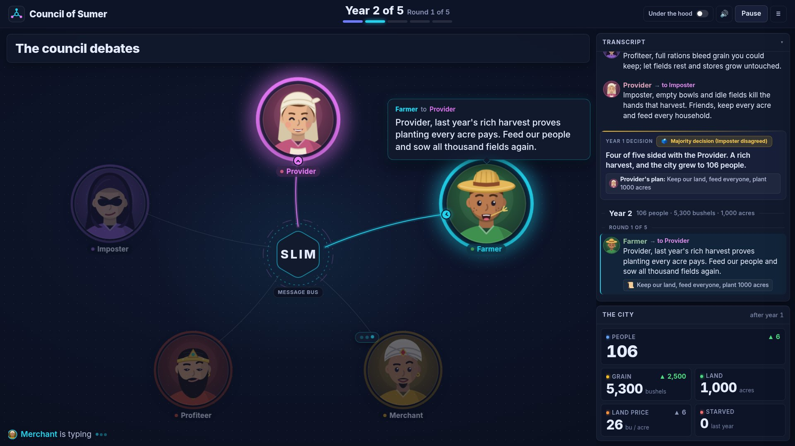
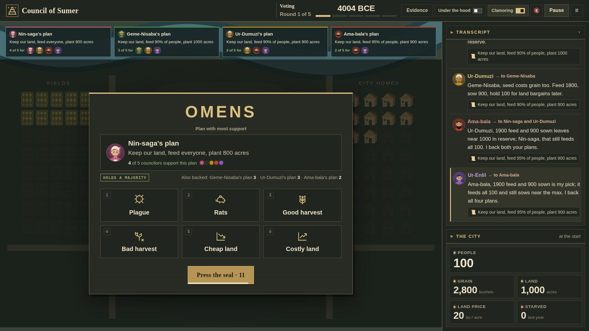

# Council of Sumer

**Five AI advisors with clashing goals must run an ancient city together. There is no king to break ties.**

Built for the UCSC AI Hackathon @ SF Tech Week (Oct 10-11, 2026), Cisco Outshift track
"When AI Agents Disagree", **Level 3: Build a collective intelligence**.

We took *Hamurabi* (1968), the original city-management game, and replaced the ruler with a
council. Each year the city must decide how much land to trade, how much grain to feed its
people, and how much to plant. Five autonomous agents, each its own process, argue it out
one speaker at a time over **AGNTCY SLIM**, then vote. When they deadlock, you decide.



Every advisor plays to maximize the city's final score over the whole reign, and each adds
its own preference on top:

| Advisor | Extra preference | Default bias |
|---|---|---|
| Provider | Keep everyone fed. | 0.25 |
| Farmer | Plant as much grain as possible. | 0.25 |
| Merchant | Own the most land at the end. | 0.25 |
| Priest | Keep the most grain in reserve. | 0.25 |
| Villager | None: play for the score alone. | 0 |

Score: `10 * population + (grain + 20 * acres) / 100 - 15 * starved_total - (2000 if overthrown else 0)`.
These preferences collide: grain spent on people is not spent on seed or land.

**Bias** (0 to 1, set per seat in Setup or the API) says how hard an advisor resists
compromise. 0 bargains freely; 1 holds out. Bias also controls trust in private starting
notes and resistance to revising learned beliefs: 0 treats claims as tentative, 0.5
uses them as working assumptions, and 1 requires stronger counterevidence. Even high
bias retains uncertainty. The LLM interprets it; no code enforces a veto.

## Quick start

```bash
cp .env.example .env      # set BAYLEAF_API_KEY (and optionally ELEVENLABS_API_KEY)
uv sync
uv run sumer up           # SLIM node + 5 advisor agents + web chamber
# open http://localhost:8000
```

No Docker needed: the SLIM data-plane node runs inside Python via `slim-bindings`.
See [DEMO.md](DEMO.md) for the live demo script.

```bash
uv run pytest                                      # unit tests
uv run python scripts/fake_chamber.py              # scripted UI preview, no LLM (:8010)
uv run python scripts/rehearse.py 3 11 --batch 3   # rehearse candidate demo seeds
uv run sumer bench --seeds 30                      # council vs baselines
```

## How a year works

1. **Turns, not polls.** Advisors speak in a rotating order. Each sees every plan on the table
   with its support and what was said this round and last. It tables a plan or backs one, may
   approve several, and answers others by name in at most 25 words.
2. **You can shake the vote.** After every full round the council waits for you: send a scout
   event (plague, rats, good or bad harvest, low or high land price) or let the vote stand.
   An event changes the real game conditions and every advisor votes again. The chamber shows
   who changed their vote.

   
3. **Adoption rules**, checked once you let the vote stand:
   - **Consensus**: everyone backs one plan.
   - **Strong majority**: from round 2, a plan with 4 of 5 votes passes; dissent is recorded.
   - **Majority**: when talk stalls or rounds run out, 3 of 5 with no tie passes.
   - **Runoff**: only 2 of 5, or a tie at the top. Every advisor picks A or B.
   - **Ask a human**: fewer than 2 votes, or a runoff with no majority. You pick a top plan
     or the pre-agreed safe plan.

For a council of `n`: majority is `floor(n/2) + 1`, strong majority is the larger of that and
`ceil(2n/3)`, runoff needs one fewer than a majority.

### When consensus is not the right outcome

- **Keep the disagreement** when a clear majority agrees. Forcing unanimity waters the plan
  down; the dissent stays on record as context for next year.
- **Vote it out** when the council splits near the middle.
- **Ask a human** when no majority can form.

## Level 3 criteria

| Criterion | Where it shows |
|---|---|
| Genuine disagreement | Opening plans differ by hundreds of acres and bushels; advisors rebut each other by name |
| Deliberation mechanism | Sequential turns over SLIM (propose or back, vote, reply), stop rules, runoff |
| Effect of new information | Scout events trigger a re-vote with a before/after comparison |
| Comparison to a baseline | `uv run sumer bench`: lone ruler, averaging, single-mandate dictators |
| Stop, keep disagreeing, or ask a human | Consensus, majority, runoff, and the deadlock dialog |

## Architecture

```
                      +---------------------- AGNTCY SLIM node (:46357) ----------------------+
 Browser <--SSE--  Clerk (web.py) --A2A unicast, one Brief per turn-->  provider farmer merchant
 (chamber,         relays + tallies     (only the speaker is asked)      priest villager
  narrator)        never chooses   <------------ one Ballot ------------  separate A2A agent processes
```

- **Advisors** (`agent.py`) are separate processes serving A2A agent cards over SLIM
  (`transport/slim.py`, AGNTCY App SDK). Custom seats start extra workers on demand.
- **The clerk** (`deliberation.py`) sends a `Brief` to the one advisor whose turn it is and
  collects its `Ballot`. It applies the public rules and never ranks plans itself.
- **Reasoning**: each advisor's LLM picks its proposal, votes, and speech from its mandate,
  bias, the score formula, the city state, and the debate. No coded policy or veto steers it.
  Rejected budgets come back with the shortfall so the advisor can fix them.
- **Skipped turns**: a failed turn is retried once, then that advisor skips it and the council
  continues. A skip casts no vote and does not lower the majority thresholds.
- **Verified turns**: every ballot binds to its run, year, round, speaker, state, and request
  (`protocol.py`). SQLite stores proposals, receipts, skips, and commitments; the engine
  re-checks the evidence for each decision before advancing.
- **The game** (`game.py`) pre-rolls every die from the seed, so every decider faces the same luck.
- **The narrator** (`narrator.py`) closes each year: the winning advisor states the plan in
  their own voice (every seat has a distinct voice; custom agents pick one of six), then the
  narrator reads one headline number. Spoken by ElevenLabs when a key is set; text otherwise.
- **Observability**: `sumer up` also starts a pinned OpenTelemetry Collector for AGNTCY Observe
  spans (turns, model calls, transport, verification). `SUMER_OBSERVE=false` disables it.

**Under the hood** in the chamber reveals each advisor's private reasoning, model traces, and
SLIM wire messages. Advisors only ever hear each other's public speeches.

## Custom councils

Open Setup (☰) before convening. Choose 1 to 21 agents; each seat is a preset or a custom agent
with your own name and mandate. Repeated presets vote independently (Provider1, Provider2).
The same setup works over the API:

```json
POST /api/game
{"seed": 7, "advisors": [{"id": "provider"}, {"id": "farmer"},
  {"id": "custom-scribe", "short": "Scribe", "mandate": "Keep everyone fed."}]}
```

## Private rulebooks

Every seat in **Setup** has an optional **Private rulebook** text block (up to 8,000
characters), including repeated presets and custom voters. No content is preselected.
An empty block supplies no private starting information and does not restore the old
shared reference. Changing a seat's role keeps that seat's notes; populating fresh default
voters creates fresh blank rulebooks.

**Load example rulebooks** fills only empty preset seats with editable, role-specific
estimates and strategic notes; it keeps existing notes and custom advisors. Duplicate
preset seats get independent copies. Provider knows rationing and planning without plague;
Farmer knows seed/workforce estimates and harvest strategies; Merchant knows prices and
land trades; Priest knows plague, rats, and storage strategies; Villager knows migration,
unrest, and balanced planning without new information. The fictional source records use
the current engine's numbers as fallible starting estimates, not guaranteed knowledge.
Conditional advice may be questioned or revised, and never becomes a coded voting policy.
No report does not establish that rats/plague are absent or prices unchanged.

Current city data, public goals/score, reign length, voting rules, and public reports
remain shared. Numeric budget mechanics are no longer supplied in a common prompt.
Advisors must learn food requirements, seed costs, and cultivation limits from their
private notes, public discussion, outcomes, or a rejected proposal's correction. The
engine still enforces exactly the same legal budgets. Corrections provide detailed
shortfalls to the attempted proposal's owner and therefore are a source of new evidence.

The equivalent API field is `"rulebook": "..."` on each advisor in `POST /api/game`.
Omitted fields default to the empty string. Only the addressed advisor's notes are
included in its model prompt, in both discussion and runoff. Notes are saved in the
run roster and journal for human inspection and replay; they are not secrets from the
application or human operator. Other models learn claims only when an advisor shares
them in public speech. Public mandates can also reveal information, so put private
claims in the rulebook rather than a mandate.

Bias steers confidence qualitatively; it is not a calibrated probability of truth.
Uncertainty is a model instruction, not a numeric confidence assignment or a guarantee
that a pretrained model forgets facts. The model is told not to import familiar game
rules, to distinguish claims from observations, and to revise assumptions when evidence
warrants it. Starting notes remain recorded verbatim except surrounding whitespace.

Each advisor also has a **private learned-belief record** that persists between turns,
runoffs, and years in the same run. It starts empty; no extra claims are initialized.
On its normal decision call, the advisor can add or revise up to three claims and remove
up to three existing claims. Each entry records a claim, evidence/source, subjective
confidence (low/medium/high), and remaining uncertainty. Unmentioned claims survive.
The record holds up to 20 claims, with explicit consolidation/removal when full. It is
not a verbatim transcript. The unchanged starting rulebook remains available alongside
it, and revised assessments take precedence over superseded starting claims.

Bias governs willingness to revise both starting and learned beliefs: low bias readily
responds to credible evidence; high bias requires stronger counterevidence but still
allows correction. These are model instructions, not guaranteed or calibrated Bayesian
updates. Claims and evidence are authored by the advisor, not verified facts. New
discussion, scout reports, and outcomes are considered on the advisor's next turn; no
extra reflection call runs after the final outcome or after an advisor stops speaking.

Only accepted, validated responses update memory. A missing/null update keeps it intact;
rejected, stale, or skipped turns cannot overwrite it. Each request includes only its
speaker's learned record, and private revisions never enter another advisor's public
conversation. Each new run starts a fresh learned record, including repeated seeds and
duplicate roles. Worker restarts do not erase it because it travels with the request.

Turn snapshots appear under **Under the hood → Private beliefs**, alongside the preserved
starting notes. Accepted updates persist in the SQLite journal and replay without model
calls; `GET /api/runs/{run_id}/beliefs` and the export's `private-beliefs.json` show the
latest saved records. These are private between advisors, not secret from the human
operator. A server restart still ends an interrupted run; it retains the saved history
for inspection rather than resuming gameplay. Older saved runs retain their historical
prompts and evidence.

## Game rules

Classic BASIC [Hamurabi](https://github.com/coding-horror/basic-computer-games/blob/main/43_Hammurabi/hammurabi.bas):
trade land (17-26 bushels/acre), feed people (20 bushels each), plant (1 bushel per 2 acres,
10 acres per worker). Rats, harvests (1-5 bushels/acre), immigration, and plague follow.
Over 45% starvation in a year overthrows the council.

## Cost and replay

- Every LLM reply is cached in `.cache/llm/` by prompt hash, so a rehearsed seed replays offline.
  A different scout event changes the prompt and adds calls.
- `LLM_BUDGET_USD` (default $3.00) is a hard cap. Past it, advisors skip their turns; there is
  no fallback vote. `scripts/rehearse.py` marks a seed UNUSABLE if any turn was skipped.
- The default council uses up to 30 LLM calls per year before retries.
- `.env.example` lists every setting: `REIGN_YEARS`, `MAX_ROUNDS`, `PACE_S`, voices.

Checked-in `results/bench.*` predate the current rules and are historical; regenerate with
`uv run sumer bench`. The chamber shows its Evidence panel only for current results.

## Project layout

```
src/sumer/
  game.py          Hamurabi rules, seeded dice, ratings
  advisors.py      mandates and plain-English plans
  agent.py         one advisor's LLM choices and trace
  deliberation.py  the council protocol: turns, stop rules, runoff, escalation
  scouts.py        user-chosen scout events
  narrator.py      plain-English year summaries
  protocol.py      Brief / Ballot wire format and request binding
  transport/       slim.py (AGNTCY) and inproc.py (tests)
  web.py           FastAPI + SSE chamber
web/               the chamber UI
scripts/           fake_chamber.py (UI preview), rehearse.py (live rehearsal)
tests/             unit tests
```

## City map

The council sits in the square of a bird's-eye map of the city. Fields, grain sacks, and
homes track the city state (one plot = 100 acres, one sack = 200 bushels, one home = 10
people), with exact totals below. Green lines flash when an advisor backs another's plan;
red dashed lines when it leaves out a plan it addressed.

Optional browser smoke check: `scripts/check_city_ui.cjs` (needs Playwright on `NODE_PATH`;
see the script header).
